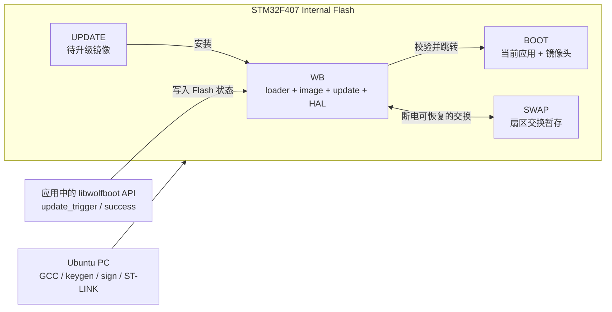
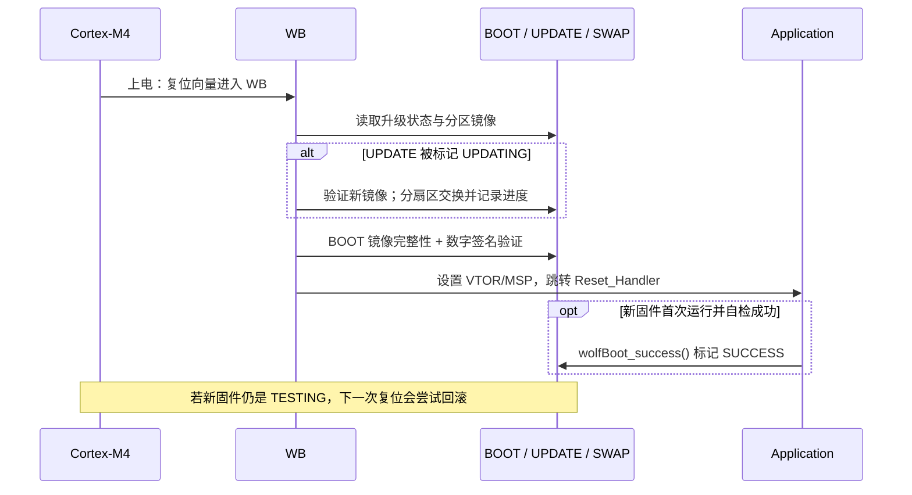
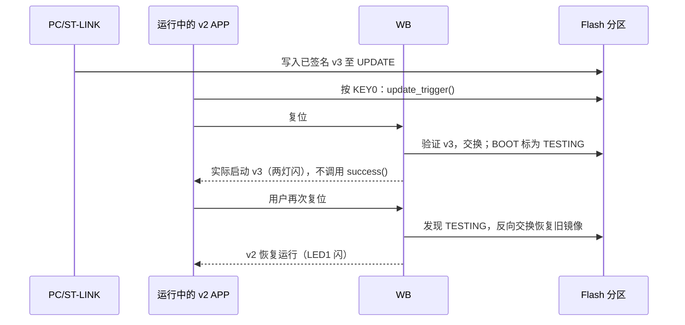

# 用探索者 STM32F407 学会 wolfBoot：先玩起来，再看懂源码

> **阅读顺序：先读 0（5 分钟），再完成第 1 部分的三个实验，最后按第 2 部分读源码。**
>
> 基线：**WB v2.10.0**（2026-10-01 正式发布）；芯片 **STM32F407ZGT6，1 MB 内部 Flash**；正点原子探索者；**8 MHz HSE**；Ubuntu + GCC + ST-LINK。原工程使用裸寄存器 HAL，不要求先学 STM32Cube HAL、RTOS 或 Zephyr。
>
> 说明：这是在官方 `stm32f407-discovery` 示例基础上的**教学移植**，不是官方已认证的“探索者板 BSP”。文章区分了**源码已核对**与**编译/硬件尚待执行**。

## 0. 先把它想成一个“上电时值班的门卫”

你熟悉 Cortex-M4 的向量表、MSP、Reset_Handler。没有 Bootloader 时，CPU 复位后直接从 `0x08000000` 对应的向量表开始执行应用。有了 wolfBoot：

1. **先跑门卫**：wolfBoot 固定放在 Flash 起点，负责决定是否能启动。
2. **检查身份证**：读取应用固件头、计算 Hash、用内置公钥验签。
3. **必要时搬家**：如果有新版本，就把 UPDATE 里的新固件交换到 BOOT；必要时反向交换，恢复旧版本。
4. **交还控制权**：取应用向量表里的 MSP 和 Reset_Handler，设置 VTOR，跳入 Application。

**你只需先记住这四个名词：**`BOOT` 是实际运行位；`UPDATE` 是候选升级位；`SWAP` 是交换时的临时仓库；`签名`证明固件来自可信发布方（不是保密/加密）。**同一时刻通常从 BOOT 运行，并不是 MCU 在 A/B 中随意直接执行。**OTA/CAN/串口只负责“把固件送来”，wolfBoot 的核心负责“验、换、保底”。





**第一个目标只要这样验收：**烧入 `factory.bin` → 重启 → LED0（PF9）规律闪烁。先不要碰 OTA 和电源中断测试。

---

# 第 1 部分｜先跑起来：从官方 Demo 改出自己的实验

## 1. 官方工程里该看哪几个目录？

这是 v2.10.0 真实存在的目录/文件，不需要一开始全读。

| 找什么 | 路径 | 一句话理解 |
|---|---|---|
| **你的起点** | `config/examples/stm32f407-discovery.config` | F407 官方配置，**Discovery 不是探索者** |
| **你的测试应用** | `test-app/app_stm32f4.c` | 官方 UART 固件接收 + LED/PWM 测试程序，适合二次开发 |
| 板级相关 | `test-app/led.c`、`timer.c`、`system.c` | 官方测试板的 LED、定时器、时钟，原来用的是 **PD14/PD15** 等引脚 |
| 真正的 MCU 适配 | `hal/stm32f4.c`、`hal/stm32f4.ld` | Bootloader 的时钟与 Flash 驱动、链接布局 |
| 编译入口 | `Makefile`、`tools/config.mk`、`test-app/Makefile` | 编 Boot、App，自动生成签名镜像和出厂镜像 |
| Bootloader 核心 | `src/loader.c`、`src/update_flash.c`、`src/image.c` | 初始化、升级决策、镜像校验 |
| APP 交互接口 | `include/wolfboot/wolfboot.h`、`src/libwolfboot.c` | APP 请求升级、查询版本、确认成功 |
| 工具/文档 | `tools/keytools/`、`docs/` | 生成公私钥、签名、参数与流程说明 |

**不要把官方 `app_stm32f4.c` 当作简易 LED Demo：它还实现了 UART 升级接收协议。**本教程先暂时替换为 `lab/app_stm32f4.c`（更小的 PF9/PF10 + KEY0 版本），源码分析阶段再回头阅读原件（脚本会备份原文件）。

## 2. 先确定 Flash 分区：这个点不能照抄官方 128 KB 示例

F407 片内 1 MB Flash，前 4 个扇区为 16 KB，第 5 个扇区 64 KB，后面为 128 KB/扇区。官方 Discovery 示例给 BOOT/UPDATE/SWAP 各 128 KB，适合看启动布局；但 **v2.10.0 的 `wolfBoot_update_trigger()` 会擦除 UPDATE 最后一个物理扇区，用来重置状态标记**。若 UPDATE 整区仅有一个 128 KB 扇区，直接按这个布局执行“应用写完 UPDATE 后触发升级”会擦除镜像本身。

因此本教程为**实验用**将 BOOT 和 UPDATE 扩为 **256 KB/区**，每区最后 128 KB 扇区保留给状态/擦除操作；演示固件必须小于前 128 KB。修改依据：`src/libwolfboot.c::wolfBoot_update_trigger()` 与 `docs/firmware_update.md`；**这是依据源码制定的布局，尚未上板验收**。

| 区域 | 地址（闭区间） | 空间 | 实际用途 |
|---|---|---:|---|
| WB | `0x08000000–0x0801FFFF` | 128 KB | 扇区 0–4；不能超链接空间 |
| BOOT | `0x08020000–0x0805FFFF` | 256 KB | 当前镜像；末扇区留给状态 |
| UPDATE | `0x08060000–0x0809FFFF` | 256 KB | 新镜像从 `0x08060000` 写；末扇区留给状态 |
| SWAP | `0x080A0000–0x080BFFFF` | 128 KB | 一整个最大物理扇区 |
| 未用 | `0x080C0000–0x080FFFFF` | 256 KB | 本实验不访问 |

本配置为 `SIGN=ED25519`、`HASH=SHA256`，预期 `IMAGE_HEADER_SIZE=256`：**BOOT 起点 `0x08020000`，应用向量表 `0x08020100`**。镜像头不能放进用户 `.text`/向量表，不能把未经签名的普通 BIN 当签名镜像写入 BOOT。

> **另外一个官方源码检查点：**`hal/stm32f4.c` 在 v2.10.0 中给 PLL 设置 `M=8,N=336,P=2`（8 MHz→168 MHz），却将 `flash_waitstates` 写成 3；ST《RM0090》表 11 规定 **2.7–3.6 V、150–168 MHz 使用 5 WS**。教学脚本将其改成 5，并将配置里的 `CLOCK_SPEED=160000000` 修为 `168000000`；请先确认开发板 MCU 供电在该电压范围内。不是盲目沿用原值。

## 3. Ubuntu 准备（首次只需执行一次）

```bash
sudo apt update
sudo apt install -y git make build-essential python3 \
  gcc-arm-none-eabi binutils-arm-none-eabi \
  stlink-tools openocd gdb-multiarch

arm-none-eabi-gcc --version
st-flash --version
openocd --version
```

从官方**固定标签**获取完整源码（包含密码库子模块）：

```bash
git clone --branch v2.10.0 --recursive \
  https://github.com/wolfSSL/WB.git
cd WB
git describe --tags --exact-match   # 预期 v2.10.0
git submodule update --init --recursive
```

把下载包中的 `lab/` 文件夹放在 `WB` 源码目录**外**或任何便于访问的位置，然后执行：

```bash
bash /path/to/lab/apply-to-wolfboot.sh "$PWD"
cat .config
git diff -- hal/stm32f4.c test-app/app_stm32f4.c
```

脚本只做三件事：拷贝本教程 `.config`；备份并替换官方 `test-app/app_stm32f4.c`；按 ST Flash 时序要求检查、修正 Bootloader HAL 的等待周期。**不会修改 WB 的镜像验证或交换算法。**脚本要求仓库确切位于 `v2.10.0` 标签；遇到不认识的源码不会强制修改。

## 4. 实验 A：先得到一个真正由 WB 启动的 LED 应用

```bash
make clean
make                       # 官方顶层 Makefile；无需自制 CMake
ls -lh wolfboot.elf wolfboot.bin factory.bin \
  test-app/image.elf test-app/image.bin test-app/image_v1_signed.bin
arm-none-eabi-size wolfboot.elf test-app/image.elf
arm-none-eabi-objdump -h test-app/image.elf | head -25
```

**你应该看到：**`wolfboot.elf`/`wolfboot.bin`、原始 `image.bin`、带签名的 `image_v1_signed.bin`、两者拼装的 `factory.bin`。查看 APP 的 `.text`/向量表段，应位于 `0x08020100` 附近。**先检查 `wolfboot.bin` < 128 KB，签名 APP < 128 KB**：

```bash
python3 - <<'PY'
from pathlib import Path
for name in ('wolfboot.bin', 'test-app/image_v1_signed.bin'):
    size = Path(name).stat().st_size
    print(f'{name}: {size} bytes')
    assert size < 0x20000, '超过本教程单扇区安全演示限制，禁止烧录'
PY
```

**烧录前：**确认 ST-LINK 的 SWD、3.3 V、电源共地；备份板内原有固件；确认 BOOT0 使上电从用户 Flash 启动。随后才执行：

```bash
st-info --probe             # 应当识别 STM32F407 / ST-LINK
st-flash write factory.bin 0x08000000
st-flash reset
```

验收：**PF9 对应 LED0 闪烁**；这证明至少跑通“签名工厂镜像→Bootloader→Application”整条链。若 LED 不闪：先核对 LED 低电平有效、8 MHz HSE、板子电压、BOOT0，再使用 OpenOCD 断点排查，不要立即修改核心算法。

## 5. 实验 B：第一次成功升级，不需要先写 OTA 协议

我们故意先用 ST-LINK 代替 CAN/OTA 将镜像放到 UPDATE；它只替代**传输**环节，升级仍由 WB 完成。`lab/app_stm32f4.c` 通过读取**镜像头里的签名版本号**决定 LED：v1 闪 LED0；v2 闪 LED1 并确认成功；v3 两灯闪但故意不确认。

在上一步已经完成初始烧录后，**不要再重新生成密钥或烧写新的 factory.bin**。直接用相同 `image.bin` 和**同一把**密钥签成 v2：

```bash
./tools/keytools/sign --ed25519 --sha256 \
  test-app/image.bin wolfboot_signing_private_key.der 2
ls -l test-app/image_v2_signed.bin
# 再确认大小 < 131072 字节！
st-flash write test-app/image_v2_signed.bin 0x08060000
st-flash reset
```

此时 CPU 仍会运行 v1；在板子正常运行、**放开 KEY0** 后，**短按 KEY0（PE4，低有效）**。演示应用执行 `wolfBoot_update_trigger()`、复位；wolfBoot 验签并交换 BOOT/UPDATE。第一次进入 v2 后应用调用 `wolfBoot_success()`。**预期：LED1 闪烁，第二次复位后仍是 LED1。**

特别注意：**只有在已确认正确地写入 UPDATE 签名镜像之后才能按 KEY0**。否则应用仍会设置升级请求；正式项目应由固件接收模块先做完整性/长度检查，而不是靠一个按钮触发。演示 LED 变化是可观察现象；是否通过升级、状态标记及中断恢复的完整验收，仍需下一阶段断点和日志验证。

## 6. 实验 C：不确认新固件，就让它自己回滚

在 v2 已稳定运行的前提下，再签 **v3**，写同一个 UPDATE 起点：

```bash
./tools/keytools/sign --ed25519 --sha256 \
  test-app/image.bin wolfboot_signing_private_key.der 3
# 同样确认 image_v3_signed.bin < 131072 字节
st-flash write test-app/image_v3_signed.bin 0x08060000
st-flash reset
```

短按 KEY0 → v3 首次启动时**两灯闪**，但教程代码**故意不调用** `wolfBoot_success()`。再按复位键 → WB 发现 BOOT 仍是 `TESTING` → 从 UPDATE 的旧镜像回滚 → **恢复 v2，LED1 闪烁**。这是升级状态机的核心现象。不要把“固件没跑起来”和“固件跑了但没确认”混成一个故障模式。



**停下检查：**三个实验都成功之前，先不要测试故意断电、恶意固件、加密 OTA 和 Bootloader 自更新。

## 7. 有问题时，按这个顺序排查

| 现象 | 第一检查点 |
|---|---|
| 编译提示找不到 wolfSSL 源码/头文件 | `git submodule update --init --recursive` |
| 找不到 ARM 编译器 | `which arm-none-eabi-gcc`，不要混用主机 gcc |
| 烧录正常但 LED 不亮 | 探索者 PF9/PF10 **低电平点亮**；检查用户 Flash 启动/时钟；确认签名头和应用向量表 |
| 停在 HSE 就绪等待 | 板载晶振是否真为 8 MHz、有无 HSE 电路/焊接问题 |
| 进入 HardFault | 检查 MSP/PC/VTOR：`0x08020100` 的前两个字必须分别是合法 SRAM 初始 MSP 和 Thumb 复位地址 |
| v2 写入了却仍启动 v1 | 是**签名镜像**而非 raw BIN 吗？UPDATE 是 `0x08060000` 吗？是否真的短按 KEY0？Bootloader 是否验签失败？ |
| v3 不回滚 | v3 必须经历一次完整升级，且 BOOT 的状态必须是 `TESTING`；回滚在**随后一次复位**发生 |

**调试入口（仓库自带配置）：**

```bash
openocd -f config/openocd/openocd_stm32f4.cfg
# 另开一个终端：
gdb-multiarch wolfboot.elf
# (gdb) target remote :3333
# (gdb) monitor reset halt
# (gdb) b hal_init
# (gdb) b wolfBoot_start
# (gdb) c
```

需要用 APP 符号看 `main` 时，在 GDB 里再执行 `add-symbol-file test-app/image.elf 0x08020100`，不要把 APP 的 ELF 当作 Flash 起点为 `0x08000000` 的 Bootloader ELF 来烧。

---

# 第 2 部分｜看懂源码：只沿着真实执行路径读

你已经会 Cortex-M4 启动和 Flash 编程，所以**不要从 `wolfCrypt` 源码或全部 `hal/` 文件看起**。先问问题、设断点、看现象，然后才读实现。

| 学习关卡 | 顺着读（v2.10.0） | 带着这个问题进入源码 | 完成标志 |
|---|---|---|---|
| 1. 先找入口 | `src/boot_arm.c` → `src/loader.c:main()` → `hal/stm32f4.c:hal_init()` | 复位后为什么先到 wolfBoot？PLL 谁配？ | 能画出从向量表到 `wolfBoot_start()` 的调用路径 |
| 2. 正常启动 | `src/update_flash.c:wolfBoot_start()` → `src/image.c` → `src/boot_arm.c:do_boot()` | 谁检查 BOOT 的 Hash/签名？谁换 VTOR/MSP？ | 用 GDB 看到 APP 的 Reset_Handler 地址 |
| 3. 升级怎么切换 | `src/libwolfboot.c:wolfBoot_update_trigger()` → `src/update_flash.c:wolfBoot_update()` | 谁写状态？谁先验签再交换？掉电后进度记在哪里？ | 解释 `UPDATING`、SWAP 扇区、`TESTING` |
| 4. 为何能回滚 | `src/libwolfboot.c:wolfBoot_success()` → `src/update_flash.c:wolfBoot_start()` | **为什么 v3 不确认、第二次复位会恢复 v2？** | 能对照状态变化讲出回滚条件 |
| 5. 最后才看 HAL/工具 | `hal/stm32f4.c`；`include/target.h`（构建生成）；`tools/keytools/` | 为什么 Flash 扇区几何和向量表偏移必须一致？签名在哪里生成？ | 能自己改分区/外设/验证镜像大小 |

**先读函数链，不读整份大文件。**你只需要记住这条主线：

```text
Cortex-M4 Reset
  -> src/boot_arm.c (启动/向量表)
  -> src/loader.c : main()
  -> hal_init()
  -> src/update_flash.c : wolfBoot_start()
     -> 读取 BOOT/UPDATE 状态
     -> 必要时 wolfBoot_update() / 恢复升级
     -> wolfBoot_open_image() / verify_integrity() / verify_authenticity()
  -> src/boot_arm.c : do_boot()
  -> Application Reset_Handler
```

然后用三次**费曼自测**检验你是不是真懂了：

1. **不用术语解释**：给别人讲，为什么只是把 `application.bin` 烧进 UPDATE 并不会自动升级？
2. **向量表自测**：为什么 APP 要链接到 `0x08020100`，但签名镜像必须写到 `0x08020000` 或（待升级时）`0x08060000`？
3. **异常自测**：如果升级刚交换完就断电，系统靠什么判断下次是继续交换、正常启动还是回滚？

想真正像大厂工程师一样掌握这套方案，最终要自己加上**镜像接收状态机（CAN/串口）→ 长度/版本/CRC/验签 → 分区写入 → 触发升级 → 健康检查 → 成功确认/回滚 → 故障记录**。但第一周只完成上面三个实验和五条源码链就够了。

## 资料链接（以固定 v2.10.0 为准）

**官方：**

- [源码固定版本 v2.10.0](https://github.com/wolfSSL/WB/tree/v2.10.0) · [Release](https://github.com/wolfSSL/WB/releases/tag/v2.10.0)
- [STM32F407 Discovery 示例配置](https://github.com/wolfSSL/WB/blob/v2.10.0/config/examples/stm32f407-discovery.config) · [原版 STM32F4 测试应用](https://github.com/wolfSSL/WB/blob/v2.10.0/test-app/app_stm32f4.c)
- [STM32F4 HAL](https://github.com/wolfSSL/WB/blob/v2.10.0/hal/stm32f4.c) · [F4 移植目标说明](https://github.com/wolfSSL/WB/blob/v2.10.0/docs/Targets.md#stm32f4)
- [编译参数](https://github.com/wolfSSL/WB/blob/v2.10.0/docs/compile.md) · [分区模型](https://github.com/wolfSSL/WB/blob/v2.10.0/docs/flash_partitions.md)
- [固件镜像头](https://github.com/wolfSSL/WB/blob/v2.10.0/docs/firmware_image.md) · [升级/回滚](https://github.com/wolfSSL/WB/blob/v2.10.0/docs/firmware_update.md)
- [应用 API](https://github.com/wolfSSL/WB/blob/v2.10.0/docs/API.md) · [签名工具](https://github.com/wolfSSL/WB/blob/v2.10.0/docs/Signing.md)
- [ST 官方 RM0090（Flash latency 表 11，Flash 扇区结构）](https://www.st.com/resource/en/reference_manual/rm0090-stm32f4xx-reference-manual-stmicroelectronics.pdf)

**便于理解的补充阅读（不作为 v2.10.0 的构建权威）：**

- [WB 官方在线用户手册](https://www.wolfssl.com/documentation/manuals/wolfboot/)
- [正点原子探索者 V3 点灯/原理图的社区整理（PF9/PF10）](https://bbs.elecfans.com/jishu_2354478_1_1.html)；最终请以你**实物对应版本原理图**为准。
- [ST-LINK Linux 开源工具](https://github.com/stlink-org/stlink) · [VS Code Cortex-Debug](https://github.com/Marus/cortex-debug)

## 交付前的验证范围

- **已完成（线上）：**GitHub Release API 确认当前最新版为 `v2.10.0`；核对配置文件、测试应用、HAL、构建规则、Boot/升级/回滚/API 关键函数及官方文档；查到官方 `wolfBoot_update_trigger()` 擦 UPDATE 末扇区的行为；核对 ST RM0090 等待周期表和探索者 LED/KEY0 引脚资料。
- **已完成（本地静态）：**文档和实验文件存在性、Shell 脚本语法、Markdown 围栏、Flash 分区不重叠/容量计算、教学 C 文件语法（如 ARM Clang 前端可用）。
- **尚未完成（必须如实保留）：**无法在当前沙盒通过 Git 克隆完整 WB 仓库，未运行 ARM GCC + 原项目完整构建，未使用你的 ST-LINK 对探索者烧录，未实测升级/回滚及断电恢复。所以三个实验的现象是**验收目标**，不是我在你的板子上已经看到的结果。
